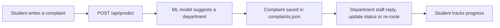

# StuDesk

**A campus complaint-routing and feedback portal.** Students describe a problem, a machine learning model suggests which department should handle it, and that department's staff reply, update the status or re-route it. Students can also send feedback and suggestions, anonymously if they wish.

Built as a Web Technology mini project (MCA) with plain HTML, CSS and JavaScript on the frontend and FastAPI on the backend. It is deliberately simple, so you can read every file and understand how a complete web application fits together.

---

## Table of contents

- [Why StuDesk](#why-studesk)
- [Features](#features)
- [How it works](#how-it-works)
- [Tech stack](#tech-stack)
- [Project structure](#project-structure)
- [Getting started](#getting-started)
- [Demo accounts](#demo-accounts)
- [Try it: a 5-minute tour](#try-it-a-5-minute-tour)
- [API overview](#api-overview)
- [Data model](#data-model)
- [Connecting your ML model](#connecting-your-ml-model)
- [Learning guide](#learning-guide)
- [Accessibility and responsiveness](#accessibility-and-responsiveness)
- [Testing](#testing)
- [Known limitations](#known-limitations)
- [Future scope](#future-scope)
- [Troubleshooting](#troubleshooting)
- [Team and credits](#team-and-credits)

---

## Why StuDesk

In a college, students often don't know which office to approach, so complaints get delayed or lost. StuDesk fixes this by routing each complaint to the right desk automatically and letting the student follow it until it is resolved.

Complaints alone feel negative, so StuDesk also has a **feedback and suggestions** side. Students can say what works well, rate services, and suggest improvements, and the admin can reply and mark ideas as implemented.

## Features

**Students**
- Register and log in
- Submit a complaint; click **Suggest department** to let the ML model choose, and override it if it is wrong
- Track all complaints with status badges (Pending, In progress, Resolved) and filter them
- Read staff replies on each complaint
- Send feedback or a suggestion with a category, a 1 to 5 rating, and an **anonymous** option
- See the admin's reply to their feedback

**Department staff**
- Dashboard of their own department's complaints, with status filter and title search
- Reply to a student, change the status, or **re-route** a complaint that was sent to the wrong department

**Admin**
- Dashboard with totals, a complaints-per-department chart, average feedback rating, and **model accuracy** (how often the model's first guess was the final department)
- Review feedback and suggestions, reply, and set status (New, Reviewed, Implemented)
- Add and remove staff accounts and departments

**Everyone**
- A live "Try the router" demo on the home page
- Responsive layout (phone, tablet, desktop) and accessibility built in

## How it works



Every page follows the same three steps:

1. **HTML** draws the page (navbar, forms, an empty table).
2. The page's **JavaScript** calls the backend with `api("/...")`, which uses `fetch` and sends the login token.
3. The JavaScript **puts the answer into the page** with `innerHTML`.

The backend is a set of FastAPI routers. Each router reads and writes JSON files through two small helpers, `read_json()` and `write_json()`.

## Tech stack

| Layer | Technology |
|---|---|
| Frontend | HTML5, CSS3 (no framework), vanilla JavaScript (ES6, `fetch`, `async/await`) |
| Backend | Python 3.10+, [FastAPI](https://fastapi.tiangolo.com/), Uvicorn, Pydantic |
| Storage | JSON files in `data/` (no database) |
| Auth | Salted PBKDF2-SHA256 password hashing, random Bearer tokens |
| ML | A department classifier behind `predict(text)`, with a keyword fallback |
| Font | [Atkinson Hyperlegible](https://www.brailleinstitute.org/freefont/) (designed for readability) |

## Project structure

```
studesk/
├── main.py                  Starts the app, plugs in the routers, serves the pages
├── seed.py                  Creates demo data (run it again to reset everything)
├── requirements.txt
│
├── model/
│   └── predictor.py         predict(text) -> (department, confidence)
│
├── routers/                 The API, one file per area
│   ├── auth.py              register, login, me
│   ├── complaints.py        departments, predict, submit, my complaints, one complaint
│   ├── staff.py             department list, status, respond, reroute
│   ├── feedback.py          send feedback, my feedback
│   └── admin.py             stats, feedback review, users, departments
│
├── utils/
│   ├── storage.py           read_json(), write_json(), new_id(), now()
│   └── auth_utils.py        password hashing, tokens, require_role()
│
├── data/                    The "database": users, complaints, feedback, departments (JSON)
│
├── templates/               The 10 HTML pages
└── static/
    ├── css/common.css       Styles shared by every page
    ├── css/pages/           One CSS file per page
    ├── js/common.js         Helpers shared by every page (api(), checkLogin(), esc() ...)
    └── js/pages/            One JS file per page
```

Each of the 10 pages has its own matching `.css` and `.js` file with the same name, for example `submit.html`, `submit.css`, `submit.js`.

| Page | Who can open it | What it does |
|---|---|---|
| `index` | Everyone | Introduction, live demo, FAQ |
| `login` | Everyone | Log in and register |
| `submit` | Student | New complaint with department suggestion |
| `my-complaints` | Student | List and filter own complaints |
| `feedback` | Student | Send feedback or a suggestion, see replies |
| `staff-dashboard` | Staff | Department complaints with filter and search |
| `complaint-detail` | Staff, and the student who owns it | Full complaint, replies, staff actions |
| `admin-dashboard` | Admin | Statistics and chart |
| `admin-feedback` | Admin | Review and reply to feedback |
| `admin-manage` | Admin | Manage users and departments |

## Getting started

### Prerequisites

- **Python 3.10 or newer** (check with `python --version`)
- A modern browser (Chrome, Edge or Firefox)
- Optional: Git and Visual Studio Code

### Install and run

```bash
# 1. Go into the project folder
cd studesk

# 2. (Recommended) create and activate a virtual environment
python -m venv .venv
.venv\Scripts\activate            # Windows
source .venv/bin/activate         # macOS / Linux

# 3. Install the dependencies
pip install -r requirements.txt

# 4. Create the demo data
python seed.py

# 5. Start the server
uvicorn main:app --reload
```

Open **http://127.0.0.1:8000** in your browser.

The interactive API tester is at **http://127.0.0.1:8000/docs**. It is the fastest way to try and understand every endpoint.

To reset the demo data at any time, run `python seed.py` again. It overwrites everything in `data/`.

## Demo accounts

All demo accounts use the password **`studesk123`**.

| Role | Email |
|---|---|
| Student | `asha@college.edu`, `ravi@college.edu`, `meera@college.edu` |
| Staff | `hostel@college.edu`, `exam@college.edu`, `fees@college.edu`, `library@college.edu`, `it@college.edu`, `academics@college.edu` |
| Admin | `admin@college.edu` |

Each browser tab keeps its own login, so you can stay logged in as a student, a staff member and the admin in three different tabs at the same time.

## Try it: a 5-minute tour

1. On the **home page**, type "The Wi-Fi in the lab is very slow" into *Try the router* and see the suggested department.
2. Log in as **asha@college.edu** and go to **New complaint**. Write a title and description, click **Suggest department**, then submit.
3. Open **My complaints** and click **View** on your new complaint.
4. Open a second tab and log in as the staff member of that department (for example `hostel@college.edu`). Open the complaint, send a reply and change the status.
5. Go back to the student tab and refresh the complaint. The reply and the new status are there.
6. As the student, send **Feedback** with a rating and tick *anonymous*.
7. In a third tab, log in as **admin@college.edu**. Check the **Dashboard**, then reply to the feedback in **Feedback**. Notice that the sender shows as "Anonymous".

## API overview

All endpoints start with `/api`. Endpoints that need a login expect the header `Authorization: Bearer <token>`, which `common.js` adds automatically. Full details and a "Try it out" button are at `/docs`.

| Method | Endpoint | Who | Purpose |
|---|---|---|---|
| POST | `/api/register` | Anyone | Create a student account |
| POST | `/api/login` | Anyone | Returns a token and the user |
| GET | `/api/me` | Logged in | Current user |
| GET | `/api/departments` | Anyone | List departments |
| POST | `/api/predict` | Anyone | `{text}` returns `{department, confidence}` |
| POST | `/api/complaints` | Student | Submit a complaint |
| GET | `/api/complaints/mine` | Student | Own complaints |
| GET | `/api/complaints/{id}` | Owner, staff of that department, admin | One complaint |
| GET | `/api/complaints/department` | Staff | Complaints of the staff member's department |
| PATCH | `/api/complaints/{id}/status` | Staff | Change status |
| POST | `/api/complaints/{id}/respond` | Staff | Add a reply |
| PATCH | `/api/complaints/{id}/reroute` | Staff | Move to another department |
| POST | `/api/feedback` | Student | Send feedback or a suggestion |
| GET | `/api/feedback/mine` | Student | Own submissions |
| GET | `/api/admin/stats` | Admin | Dashboard numbers |
| GET | `/api/admin/feedback` | Admin | All feedback, optional filters `type`, `category`, `status` |
| PATCH | `/api/admin/feedback/{id}` | Admin | Set status and reply |
| GET, POST | `/api/admin/users` | Admin | List users, add a staff member |
| DELETE | `/api/admin/users/{id}` | Admin | Remove a user |
| GET, POST | `/api/admin/departments` | Admin | List, add a department |
| DELETE | `/api/admin/departments/{id}` | Admin | Remove a department |

Common responses: `401` means you are not logged in, `403` means your role is not allowed, `400` or `422` means the data failed validation.

## Data model

Data lives in four JSON files inside `data/`.

**`users.json`**
```json
{ "id": "u8", "name": "Asha Rao", "email": "asha@college.edu",
  "password_hash": "salt$hash", "role": "student", "department": null }
```
`role` is `student`, `staff` or `admin`. Staff have a `department`. Passwords are never stored as typed.

**`complaints.json`**
```json
{ "id": "c1", "user_id": "u8",
  "title": "Wi-Fi not working in Block B",
  "description": "No internet since Monday in rooms 201 to 220.",
  "predicted_department": "it", "department": "it", "confidence": 0.85,
  "status": "in_progress", "priority": "normal",
  "created_at": "2026-10-02T10:00:00", "updated_at": "2026-10-03T10:30:00",
  "responses": [ { "by": "IT Services Staff", "message": "A technician has been assigned.", "at": "2026-10-03T10:30:00" } ] }
```
`status` is `pending`, `in_progress` or `resolved`. `predicted_department` is what the model said and never changes. `department` is where the complaint is now, and changes if staff re-route it. Comparing the two gives the model accuracy.

**`feedback.json`**
```json
{ "id": "f2", "user_id": "u9", "anonymous": true,
  "type": "feedback", "category": "canteen",
  "title": "Food quality has improved", "message": "The new menu is much better.",
  "rating": 5, "status": "reviewed", "admin_reply": "Thanks, shared with the canteen team.",
  "created_at": "2026-10-03T12:00:00", "updated_at": "2026-10-03T12:00:00" }
```
`type` is `feedback` or `suggestion`. `status` is `new`, `reviewed` or `implemented`. When `anonymous` is true, the admin endpoint removes `user_id` and shows "Anonymous", while the student can still find their own item.

**`departments.json`**
```json
{ "id": "hostel", "name": "Hostel", "description": "Rooms, mess, warden issues" }
```

## Connecting your ML model

StuDesk works out of the box using a simple keyword search, so you can build and demo everything without a trained model. To use your own:

1. Run your model as a service with a `predict` endpoint that accepts `{"text": "..."}` and returns something like `{"department": "it", "confidence": 0.87}`.
2. Open `model/predictor.py`.
3. Set `MODEL_URL` (or the `MODEL_URL` environment variable) to your endpoint.
4. Change the two lines marked `>>> ADJUST` so the key names match your model's response.

The department names your model returns must match the department ids: `hostel`, `exam`, `fees`, `library`, `it`, `academics`. If your labels are different, either change the ids in `seed.py` or map them in `predictor.py`. If the model is off or fails, StuDesk falls back to keywords instead of crashing.

## Learning guide

This project is meant to be **read**, not just run. Follow this path.

### Suggested reading order

1. **Run it and click through all three roles** (see the tour above). Know what the product does before reading any code.
2. **`static/js/common.js`**: how every page talks to the backend. Focus on `api()` (`fetch`, `async/await`, the `Authorization` header) and `checkLogin()`.
3. **Follow one feature end to end**: `templates/submit.html` -> `static/js/pages/submit.js` -> `routers/complaints.py` (`POST /api/complaints`) -> `utils/storage.py` -> `data/complaints.json`. If you understand this one path, you understand the whole project.
4. **Login and security**: `routers/auth.py` and `utils/auth_utils.py` (hashing, tokens, `Depends`, `require_role`).
5. **Staff and admin logic**: `routers/staff.py` (permission checks) and `routers/admin.py` (stats, anonymous privacy).
6. **Styling**: `static/css/common.css` (variables, grid, flexbox, media query for the table), then one page CSS file.
7. **Accessibility**: read the HTML in `templates/` for labels, headings, landmarks, the skip link and `fieldset`.
8. **Plug in a model**: replace the keyword fallback (see above).

### Where to see each concept

| Concept | Where to look |
|---|---|
| HTTP methods and REST endpoints | `routers/*.py`, and `/docs` in the browser |
| JSON as storage | `utils/storage.py`, `data/` |
| Input validation (Pydantic `BaseModel`) | the `...In` classes at the top of each router |
| Dependency injection (`Depends`) | `Depends(require_role("staff"))` in the routers |
| Authentication vs authorization (401 vs 403) | `utils/auth_utils.py` |
| Password hashing and salting | `hash_password()` in `utils/auth_utils.py` |
| Bearer tokens | `create_token()`, and `api()` in `common.js` |
| `fetch` and `async/await` | `static/js/common.js`, every page script |
| DOM manipulation | `innerHTML`, `getElementById` in the page scripts |
| Preventing XSS | `esc()` in `common.js`, used before every `innerHTML` |
| CSS Grid (`auto-fit`) and Flexbox | `.grid`, `.navbar`, `.inline` in `common.css` |
| Media queries | the 640 px table-to-cards rule in `common.css` |
| Semantic HTML and accessibility | the 10 files in `templates/` |
| Role-based access | `checkLogin()` on the frontend, `require_role()` on the backend |

### Exercises

**Beginner**
- Change `--brand` in `common.css` and watch the whole site change colour.
- Add a new question to the FAQ in `index.html`.
- Log in as admin, add a new department, then submit a complaint to it.

**Intermediate**
- Add a **priority** dropdown (low, normal, high) to the complaint form. The data already has a `priority` field. You will touch `submit.html`, `submit.js` and `routers/complaints.py`.
- Add a "Cancel complaint" button for students.
- Sort the staff dashboard by date or status.

**Advanced**
- Replace the in-memory tokens with JWT that expires.
- Replace the JSON files with SQLite using SQLAlchemy.
- Add `aria-live` to the message paragraphs so screen readers announce results.
- Write automated tests for the API with `pytest` and FastAPI's `TestClient`.
- Retrain the model and show a confusion matrix on the admin dashboard.

### Good references

- [FastAPI tutorial](https://fastapi.tiangolo.com/tutorial/)
- [Pydantic documentation](https://docs.pydantic.dev/)
- [MDN Web Docs](https://developer.mozilla.org/) for HTML, CSS, JavaScript and the Fetch API
- [WCAG 2.2](https://www.w3.org/TR/WCAG22/) and the [WebAIM Contrast Checker](https://webaim.org/resources/contrastchecker/)

## Accessibility and responsiveness

**Responsive**
- Mobile-first layout with the viewport meta tag
- Grids that adapt (`repeat(auto-fit, minmax(...))`) and a wrapping navbar
- Tables turn into stacked cards below 640 px, with no sideways scrolling
- Controls are at least 44 px tall for touch

**Accessible**
- Semantic landmarks (`header`, `nav`, `main`, `footer`), one `h1` per page, no skipped heading levels
- A "Skip to main content" link and a clearly visible focus outline
- A visible `<label>` for every field, and `fieldset` with `legend` for the rating group
- Text contrast of at least 4.5:1, and interface contrast of at least 3:1
- Status is always written as text, never colour alone
- Native HTML validation (`required`, `minlength`) and a `prefers-reduced-motion` rule
- Native elements (such as `details`/`summary`) are used instead of ARIA wherever possible

## Testing

- **API**: open `/docs`, click an endpoint, then **Try it out**. Log in through `/api/login` and add the token with the **Authorize** button.
- **Responsiveness**: in Chrome press `F12`, switch on the device toolbar, and check about 375 px (phone), 768 px (tablet) and 1280 px (desktop).
- **Accessibility**: run Lighthouse (Accessibility category) from the DevTools, run the [WAVE](https://wave.webaim.org/) extension, and try using the whole site with only the keyboard (Tab, Shift+Tab, Enter, Space).
- **Roles**: log in as each role and try opening another role's page. You should be redirected, and the API should answer `403`.

## Known limitations

StuDesk is a learning project. Being honest about its limits is part of understanding it.

- **JSON files, not a database.** They are fine for a demo, but two people writing at the same instant could overwrite each other.
- **Tokens live in memory.** Restarting the server logs everyone out, and tokens do not expire on their own.
- **The token is kept in `sessionStorage`.** That is simple, but a real system would use secure, HTTP-only cookies or short-lived JWTs.
- **No HTTPS, rate limiting or email verification.**
- **The model is simple.** Predictions are only as good as the training data, which is why staff can re-route.

## Future scope

- Move to a real database (SQLite or PostgreSQL)
- JWT with expiry and refresh, or secure cookies
- Email or SMS notifications when a complaint changes
- File and photo attachments
- Complaint priority, deadlines and escalation
- Retrain the model on real complaints and show its accuracy over time
- Multi-language support
- Automated tests and a deployment setup

## Troubleshooting

| Problem | Fix |
|---|---|
| `ModuleNotFoundError: No module named 'utils'` | Run the command from the project root, the folder that contains `main.py`. |
| `uvicorn` is not recognised | Activate the virtual environment, or run `python -m uvicorn main:app --reload`. |
| `TypeError: unsupported operand type(s)` when starting | You need Python 3.10 or newer. |
| You are sent back to the login page | The server restarted, so your token is gone. Log in again. |
| Port 8000 is already in use | Run `uvicorn main:app --reload --port 8001`. |
| A new complaint is rejected with "That department does not exist" | Your model returned a label that is not a department id. See [Connecting your ML model](#connecting-your-ml-model). |
| The page looks fine but the font looks different | The Google font could not load (offline). The fallback fonts are used, and everything still works. |
| Data looks broken or you want a fresh start | Run `python seed.py`. |

## Team and credits

Web Technology mini project, MCA, Web Technologies Lab (MCA-4143), School of Computer Engineering, M.I.T., Manipal.

| Name | Reg. No. | Modules |
|---|---|---|
| [Name 1] | [Reg. No.] | Home, Login/Register, Feedback |
| [Name 2] | [Reg. No.] | Submit Complaint, My Complaints |
| [Name 3] | [Reg. No.] | Department Dashboard, Complaint Detail |
| [Name 4] | [Reg. No.] | Admin Dashboard, Feedback Review, Manage |

Guided by: [Faculty Name]

Font: Atkinson Hyperlegible by the Braille Institute.

**License:** [Add a license if you publish this, for example MIT.]
